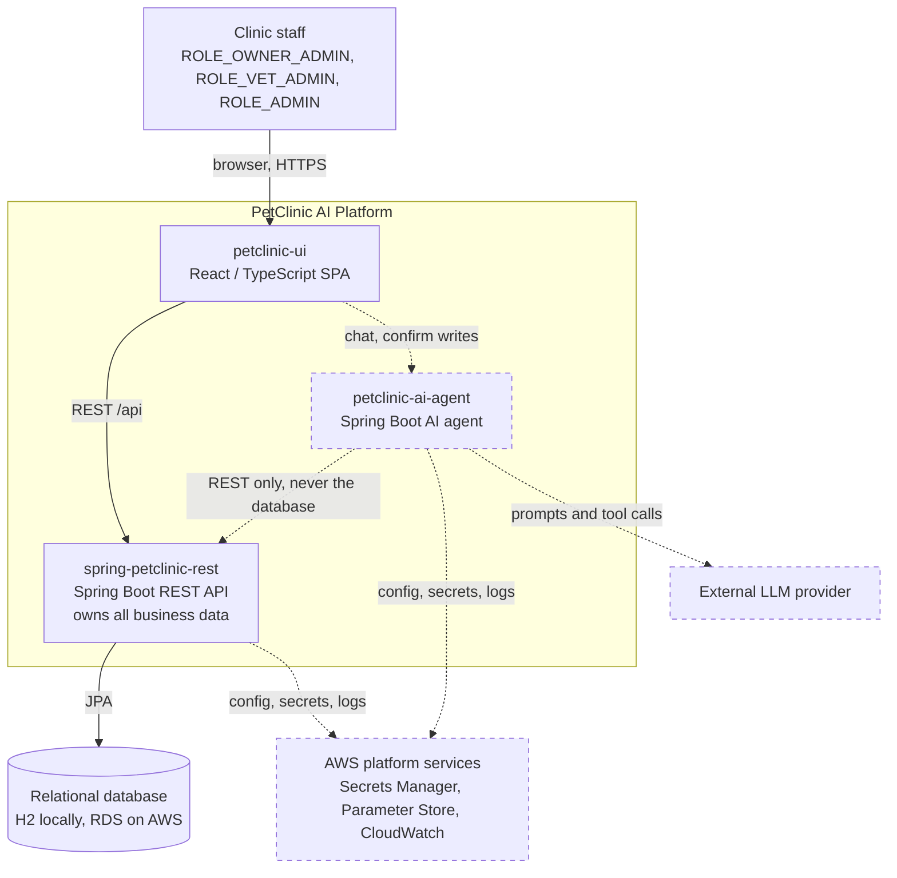

# System context

Who uses the platform and which systems it depends on. Dashed = target, not built yet.

## Notes

- **The agent never touches the database.** It is an ordinary authenticated REST client of
  `spring-petclinic-rest` ([ADR-0002](../../adr/0002-separate-ai-agent-from-ui-and-rest-api.md)).
- **PetClinic owns business data.** The agent holds no persistent copy of owners, pets or visits.
- **The UI talks to both backends directly** and is where human confirmation of AI-initiated
  writes is surfaced.
- The UI-to-agent edge, the agent and everything on AWS are target state; today the UI calls only
  the REST API and runs locally.
