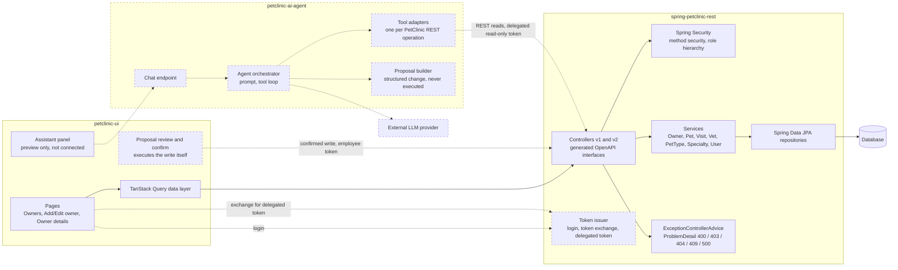
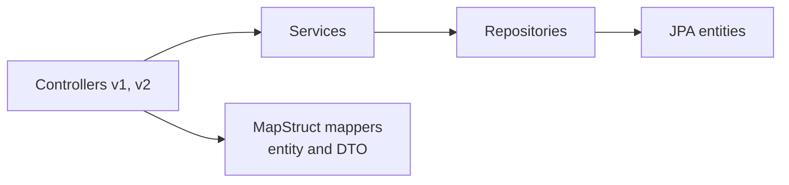

# Components

Responsibilities and dependencies of the major services. Dashed = target, not built yet.

## Platform level

## Responsibilities

| Component | Responsible for | Depends on | Must not |
|---|---|---|---|
| `petclinic-ui` | Screens, navigation, search/sort/paging state, rendering AI proposals, executing a confirmed write | REST API, agent | Hold model credentials or call the LLM |
| Controllers | HTTP mapping, input validation, `@PreAuthorize` per method | Services, generated DTOs, MapStruct mappers | Contain business rules |
| Services | Business rules per aggregate (`PetService` is the only one that calls another service, `PetTypeService`) | Repositories | Be reached by the agent except through a controller |
| Repositories | Persistence, including the case-insensitive owner prefix search | Database | |
| `ExceptionControllerAdvice` | Mapping errors to RFC 7807 `ProblemDetail` | | Leak stack traces |
| `petclinic-ai-agent` | Conversation, read-tool selection, turning a model decision into a structured proposal | LLM provider, REST API (as the employee) | Connect to the database; write at all; keep state across users |

## Backend layering (built)

