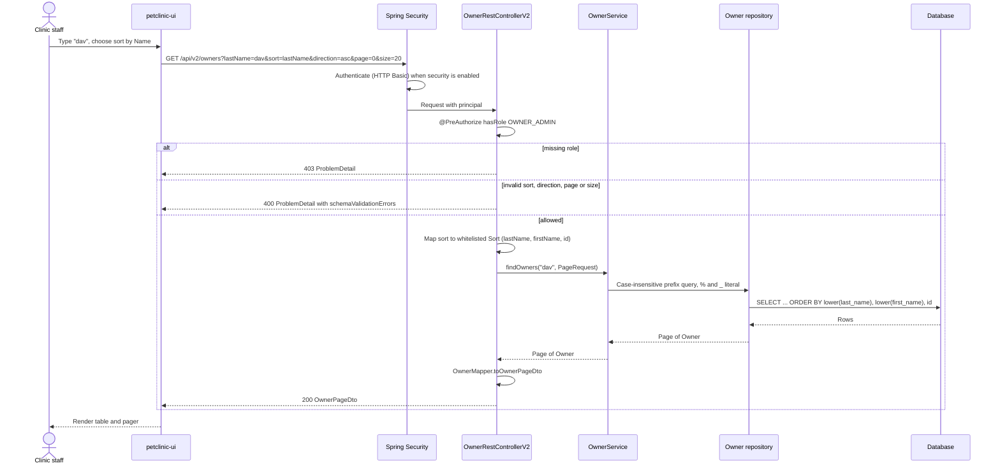

# Sequences

## 1. Owner search (built)

The Owners page searching by last name, sorted by last name, first page. Source:
`OwnerRestControllerV2.listOwnersPage` and `GET /api/v2/owners` in `openapi.yml`.



## 2. AI tool call (target, not built)

A read tool call, then an AI-proposed write. Rules: the agent uses REST only and acts as the
requesting employee, it has no write tool, and a human confirms before anything changes
([ADR-0007](../../adr/0007-ai-agent-acts-on-behalf-of-the-employee.md)).

```mermaid
sequenceDiagram
    actor Staff as Clinic staff
    participant UI as petclinic-ui
    participant Agent as petclinic-ai-agent
    participant LLM as External LLM provider
    participant API as spring-petclinic-rest
    participant DB as Database

    Staff->>UI: "Find owners named Davis and update George's phone"
    Note over UI,Agent: The UI exchanges the employee's token for a delegated read-only token (act = agent) at the issuer
    UI->>Agent: POST chat message with the delegated token only
    Agent->>LLM: Prompt and read-only tool definitions
    LLM-->>Agent: Tool call searchOwners(lastName="Davis")

    Note over Agent,API: Read, made as the employee, so the backend applies the employee's roles
    Agent->>API: GET /api/v2/owners?lastName=Davis (delegated read-only token)
    alt employee lacks OWNER_ADMIN
        API-->>Agent: 403 ProblemDetail
        Agent-->>UI: Not permitted
    else allowed
        API->>DB: Query
        DB-->>API: Rows
        API-->>Agent: 200 OwnerPageDto
        Agent->>LLM: Tool result (only data the employee may see)
        LLM-->>Agent: Proposal UPDATE_OWNER_TELEPHONE(ownerId 1, telephone 6085551023)
        Agent->>Agent: Validate against the closed proposal schema
        Agent-->>UI: Proposal, nothing executed
        UI->>UI: Validate again, map the operation to a fixed GET and PUT
    end

    Note over UI,API: Write, executed by the UI, never by the agent
    UI->>API: GET /api/owners/1 (fresh "before")
    API-->>UI: Current owner
    UI-->>Staff: Show exact before and after, Confirm or Reject

    alt Staff rejects
        Staff->>UI: Reject
    else Staff confirms
        Staff->>UI: Confirm
        UI->>API: GET /api/owners/1 (confirm-time check; replaced by If-Match and 412 later)
        API-->>UI: Current owner
        alt owner changed since review
            UI-->>Staff: Owner changed, review the new values
        else unchanged
            UI->>API: PUT /api/owners/1 with the displayed payload (employee token)
            API->>API: Authenticate, @PreAuthorize hasRole OWNER_ADMIN, validate
            API->>DB: Update
            API-->>UI: 204
            UI-->>Staff: Updated owner
        end
    end
```

Why the UI executes the write: a dialog is consent, not authorization. Because the agent holds
no write capability, a bug or prompt injection in the agent cannot change data, and the payload
sent is by construction the payload the employee reviewed. Both the reads and the final write are
authorized by the backend against the employee, never against the agent.
