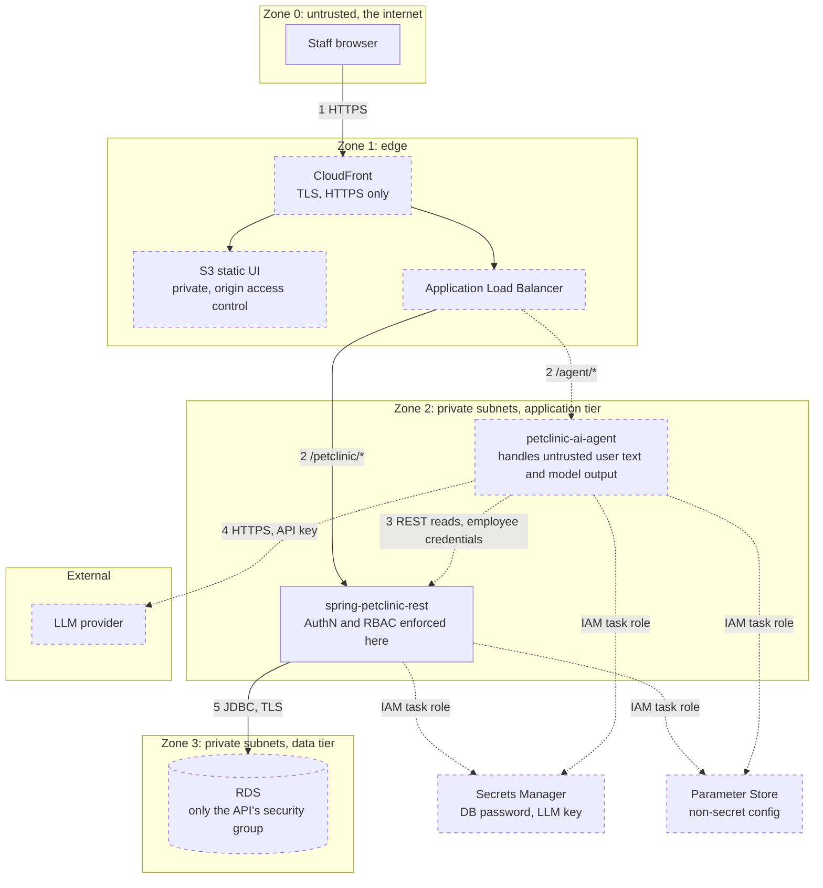
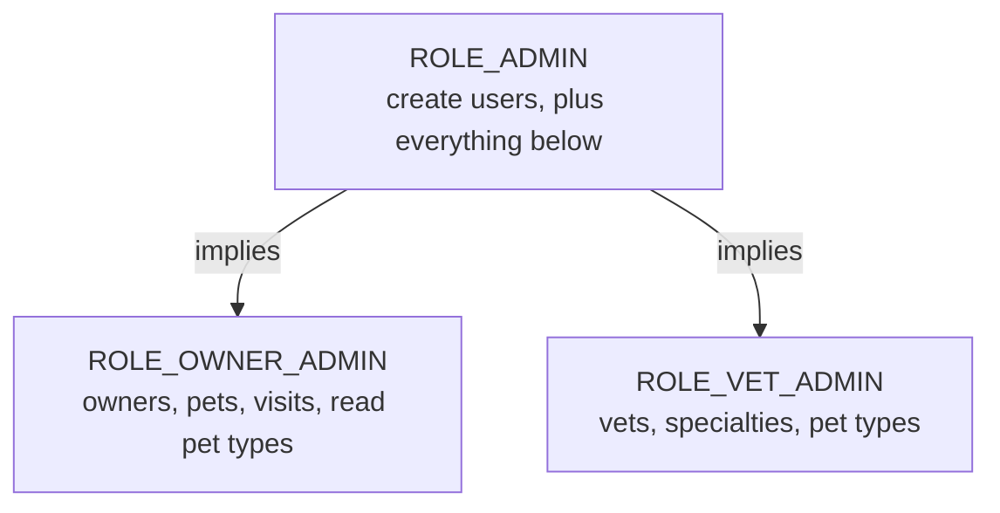

# Security

Authentication, RBAC, IAM and trust boundaries. Dashed = target, not built yet.

## Trust boundaries and flows

Boundary crossings that need a control:

| # | Crossing | Control |
|---|---|---|
| 1 | Internet to edge | TLS, CloudFront in front of everything |
| 2 | Edge to application | Only the ALB is public; tasks have no public IP; the API still authenticates every request itself |
| 3 | Agent to API | The request carries the employee's credentials and the API authorizes the employee; the agent's own credential has no data authority; no network-level trust |
| 4 | Agent to LLM | Egress via NAT; API key from Secrets Manager; prompts must not contain more data than the task needs |
| 5 | API to database | Security group allows only the API tasks; database credentials from Secrets Manager |

## Authentication (built, off by default)

- `petclinic.security.enable=false` (the default) activates `DisableSecurityConfig`, which permits
  every request unauthenticated. **Anything deployed must set it to `true`.**
- `true` activates `BasicAuthenticationConfig`: HTTP Basic, BCrypt hashes, users and roles read
  from the `users` and `roles` tables by JDBC. CSRF is disabled, which is acceptable for a
  stateless Basic-auth API but must be revisited if cookies or sessions are ever added.
- Basic credentials are only safe over TLS, so TLS terminates at CloudFront and the ALB.

## RBAC (built)

- Enforced per controller method with `@PreAuthorize("hasRole(@roles.X)")`.
- `ROLE_ADMIN > ROLE_OWNER_ADMIN` and `ROLE_ADMIN > ROLE_VET_ADMIN` come from a `RoleHierarchy`
  bean ([ADR-0006](../../adr/0006-admin-role-hierarchy.md)); `OWNER_ADMIN` and `VET_ADMIN` do not
  imply each other.
- A denied check answers 403, not 500
  ([note](../authorization-denied-status-code.md)).
- **Roles are not split into read and write** (`OWNER_ADMIN` gates owner reads and writes).
  That is why the agent acts as the employee instead of holding a role of its own: a global
  read role would let a `VET_ADMIN` read owner data through the assistant (confused deputy).
- **The hierarchy is unchanged** by the agent work
  ([ADR-0007](../../adr/0007-ai-agent-acts-on-behalf-of-the-employee.md)). An agent-origin
  ceiling (for example no non-`GET`) is a separate restrictive check, because a role hierarchy
  can only add authority.

## IAM (target)

| Principal | Allowed | Not allowed |
|---|---|---|
| API task role | Read its DB secret and its Parameter Store path; write its own CloudWatch log group | Read the agent's secrets |
| Agent task role | Read its own secrets (LLM key) and Parameter Store path; write its own log group | Read the DB secret; any RDS access |
| ECS task execution role | Pull images from ECR, write logs, inject secrets at startup | Anything at runtime inside the app |
| CI deploy role | Push images, update ECS services (assumed through GitHub OIDC, no long-lived keys) | Read secret values |

Each service gets its own task role and its own secrets so that compromising the agent does not
yield database access, which backs the architecture rule structurally.

## AI-specific risks

- **Prompt injection.** The agent reads user-typed text (owner names, visit descriptions), so
  data can carry instructions. Treat model output as untrusted input: tools are a fixed
  allowlist, and the backend validates every call as it would any client's.
- **Confirmation is consent, not authorization.** The UI dialog proves a human agreed; the
  backend still enforces what is permitted. The agent has no write tool; the UI executes the
  confirmed write with the employee's credentials and the exact payload shown.
- **Confused deputy.** The agent's reach equals the requesting employee's, never more.
- **Data to the LLM and cross-user state.** Only data the employee may see goes into a prompt;
  agent memory and caches are per user.
- **Interim credential handling.** While auth is HTTP Basic, the agent forwards the employee's
  header per request and must never store, log or prompt it.
- **Audit.** The backend logs a structured event per AI-assisted write (employee, target,
  outcome and time are server-derived; no record contents). The "AI-assisted" mark, operation and
  proposal id come from the browser, so they are claims, not proof; the agent logs its proposals
  so they can be corroborated. A tamper-resistant trail needs server-side confirmation records.
- **Secrets.** The LLM key never goes to the browser; employee credentials never go to logs,
  prompts, images or repository config.
