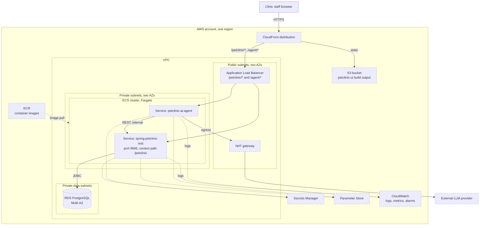

# Deployment (AWS)

How the system is meant to run. **Nothing here exists yet**: there is no infrastructure code and
the applications run only locally (`./mvnw spring-boot:run`, `npm run dev`). The services and
their names come from `CLAUDE.md`; the network layout is an assumption (see the
[README](README.md)).

## Elements

| Element | Purpose | Notes |
|---|---|---|
| CloudFront + S3 | Serve the React build; single public entry point | S3 stays private, reached through origin access control |
| ALB | Path-based routing to the two services | Only public component in front of the tasks |
| ECS Fargate services | One service per application, scaled independently ([ADR-0002](../../adr/0002-separate-ai-agent-from-ui-and-rest-api.md)) | Images built with Jib (already configured for the API) or a Dockerfile |
| RDS PostgreSQL | System of record | Reachable from the API's security group only, not the agent's |
| Secrets Manager | DB password, LLM API key, token signing keys | Injected as environment variables by the execution role |
| Parameter Store | Non-secret config such as `petclinic.security.enable`, feature switches | |
| CloudWatch | Logs, metrics from Actuator, alarms | |

## Things to settle before building

- The agent's internal call to the API goes through the ALB in this diagram; ECS Service Connect
  or an internal ALB would keep it off the public path.
- Deployed configuration must set `petclinic.security.enable=true` and must not use the in-memory
  `h2` profile, which reloads seed data on every restart.
- Agent and API must be rolled out together when a REST contract changes, or the API versioned.
